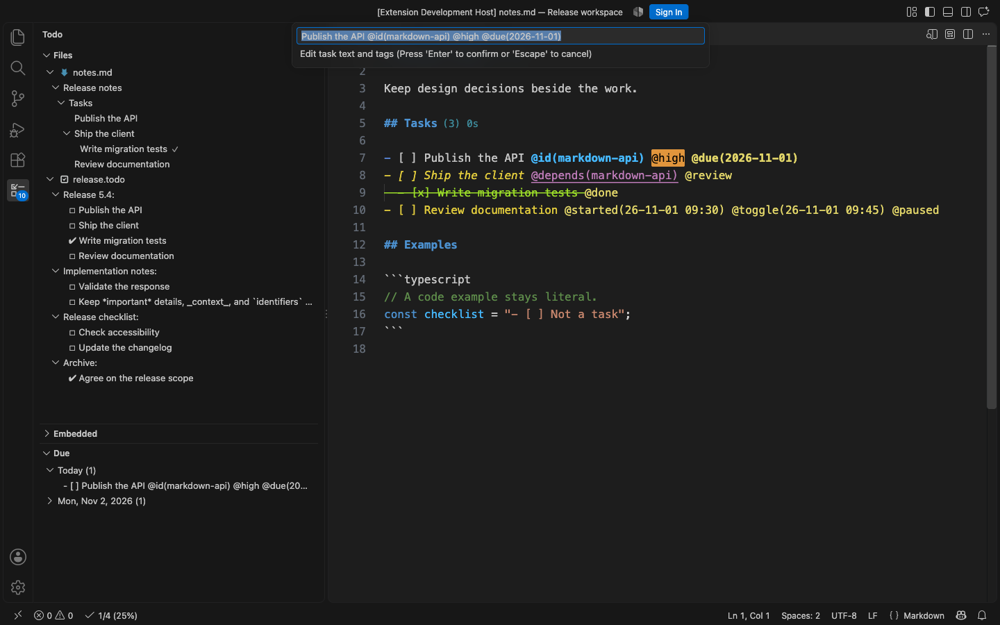
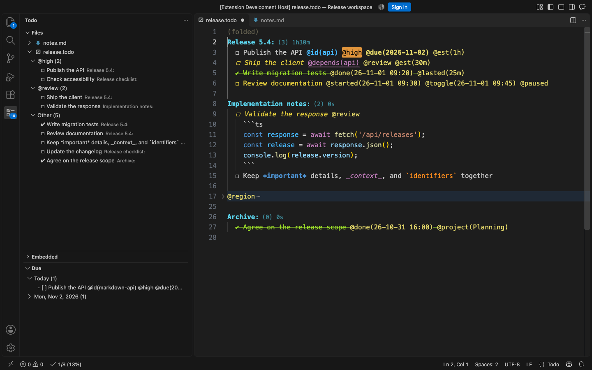
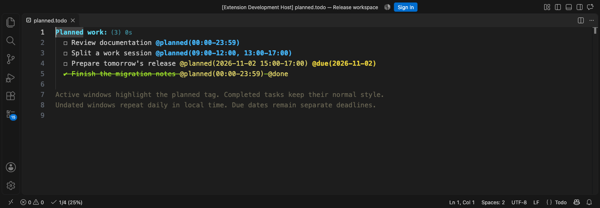
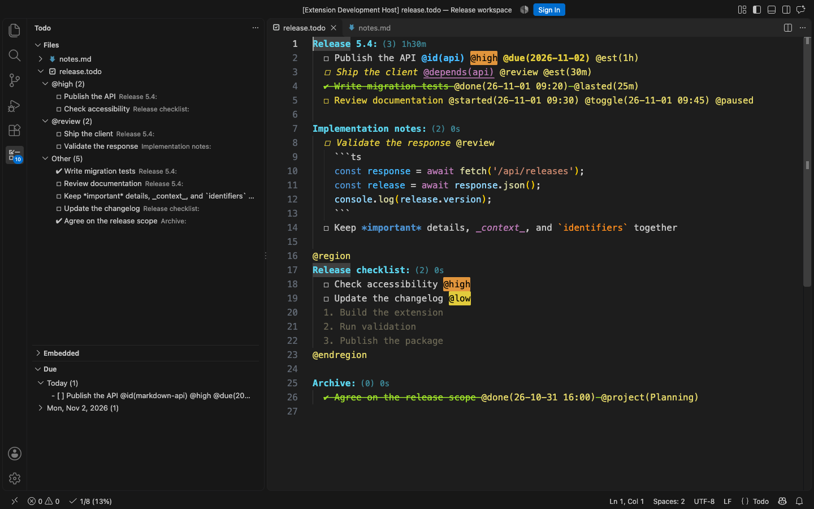
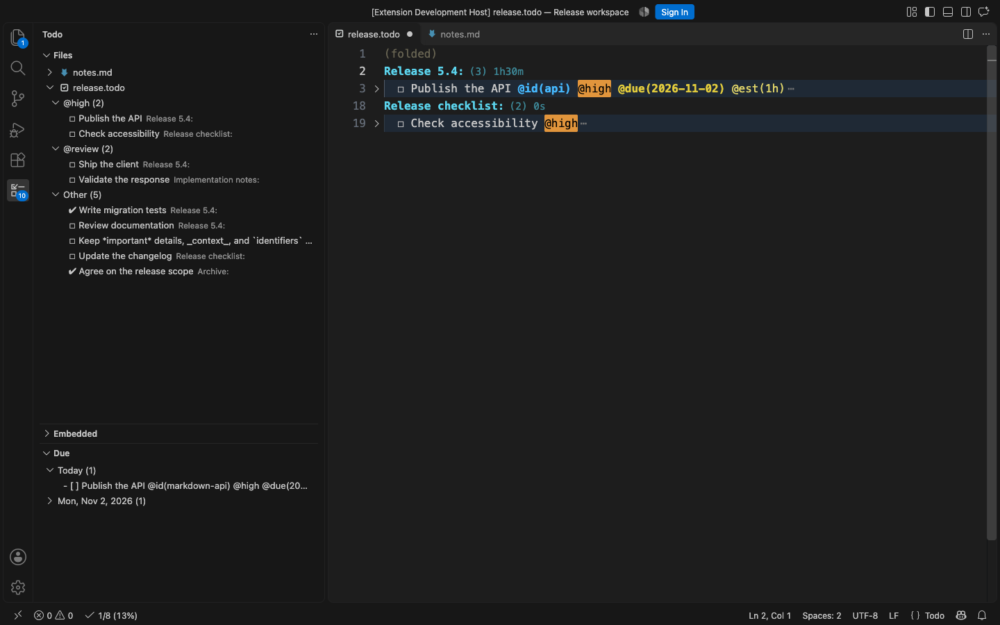
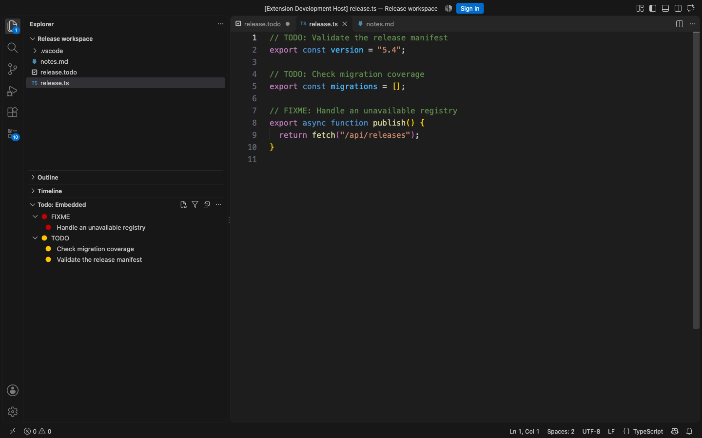
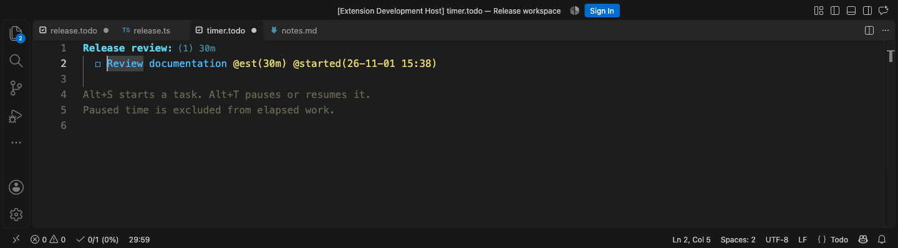
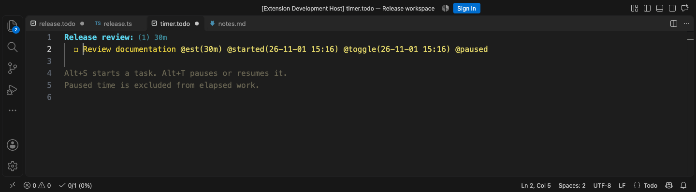
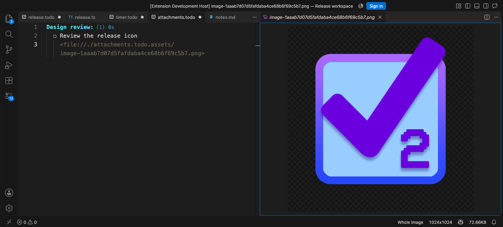

#  Todo+2

A lightweight, plain-text todo manager for Visual Studio Code. Powerful, customizable and easy to use. [View the demo](#demo).
This extension is a continuation of the original Todo+ extension by [Fabio Spampinato](https://github.com/fabiospampinato/vscode-todo-plus) and includes changes to commands, settings, and task styling. See the [compatibility notes](#compatibility) when upgrading.

[](https://marketplace.visualstudio.com/items?itemName=vycdev.vscode-todo-plus-two) [](https://marketplace.visualstudio.com/items?itemName=vycdev.vscode-todo-plus-two) [](https://marketplace.visualstudio.com/items?itemName=vycdev.vscode-todo-plus-two&ssr=false#review-details) [](https://github.com/vycdev/vscode-todo-plus-two/actions/workflows/check.yml) [](LICENSE) [](https://www.patreon.com/cw/vycdev)

## Features

- **Plain-text tasks**: projects, nested todos, notes, custom symbols, inline formatting, and numbered lists.
- **Markdown notes**: manage checklists alongside prose without changing Markdown language mode or preview.
- **Files, Due, and Embedded views**: browse tasks, edit titles and tags, change status, filter, group by tag, and arrange embedded comments.
- **Tags and focus**: priority labels, configurable task styles, region folding, and focus on a selected tag.
- **Time and progress**: start/pause/resume timers, estimate work, track elapsed time, and show project and status bar statistics.
- **Planned work**: opt in to local-time work windows with `@planned(...)`, including daily sessions and dated ranges.
- **Dependencies**: portable task IDs, cross-file links, reference completion and renaming, and checks before completion.
- **Notes and attachments**: fenced code highlighted by installed language grammars, relative file links, and PNG/JPEG paste.
- **Archive and export**: move completed work to same-file or separate archives; export Todo files to HTML or Markdown.

[Get started](#getting-started) · [Commands and shortcuts](#commands-and-shortcuts) · [Settings](#settings) · [Screenshots](#demo)

## Install

Requires Visual Studio Code 1.36 or newer. Install [Todo+2 from the Marketplace](https://marketplace.visualstudio.com/items?itemName=vycdev.vscode-todo-plus-two), or open Quick Open (Ctrl/Cmd+P) and enter:

```text
ext install vycdev.vscode-todo-plus-two
```

### Compatibility

The core extension supports VS Code 1.36+. Embedded drag-and-drop requires 1.66+, moving views into Explorer requires 1.46+, and image paste requires 1.97+. Older supported versions keep the remaining features and embedded Move Up/Down actions.

This README describes the current `develop` branch, including upcoming 5.4 features; the Marketplace release may differ. See [CHANGELOG.md](CHANGELOG.md) for release and migration notes. In particular, `Todo: Toggle Timer` now pauses/resumes the selected task; `Todo: Toggle Status Bar Timer` controls visibility. Statistics conditions use restricted expressions rather than arbitrary JavaScript. Task-text styles follow literal tags, so existing symbol-only completed tasks use syntax-theme styling until tagged.

## Getting started

1. Open a workspace folder and run **Todo: Open** from the Command Palette (Ctrl/Cmd+Shift+P). This opens or creates the configured Todo file (`TODO` by default). You can also create a `.todo` file directly.
2. Write a project heading ending in a colon, then indent tasks beneath it. Ctrl/Cmd+Enter adds or removes a task box; Alt+D completes or reopens a task.
3. Open the **Todo** activity bar icon. **Files** contains Todo files and Markdown notes; **Due** collects unfinished tasks with due dates; **Embedded** finds task comments in source files.

```todo
Release:
  ☐ Publish the API @id(api) @high @due(2026-11-02) @est(1h)
  ☐ Ship the client @depends(api)
  ✔ Write migration tests @done
```

Use `☐`, `✔`, and `✘` for pending, done, and cancelled tasks, or use Markdown checkboxes. Custom symbols are configurable. A colon creates a project, indentation creates hierarchy, and ordinary lines become notes. Todo inline formatting uses `*bold*`, `_italic_`, `~strikethrough~`, and backticks for code.

In an existing Markdown note, add `- [ ] A task` under a heading. The same task commands work there while preserving the source marker and surrounding prose. [Markdown discovery and scoping](#tasks-in-markdown-notes) control which notes and sections appear.

## Commands and shortcuts

Run these commands from the Command Palette. Availability follows the active document and task context.

| Command (Todo: prefix)                                | Action / default shortcut                                            |
| ----------------------------------------------------- | -------------------------------------------------------------------- |
| Open / Open Embedded                                  | Open the Todo file / generate an embedded-task snapshot              |
| Toggle Box                                            | Ctrl/Cmd+Enter or Alt+Enter                                          |
| Toggle Done / Toggle Cancelled                        | Alt+D / Alt+C                                                        |
| Toggle Start / Toggle Timer                           | Alt+S / Alt+T (pause or resume)                                      |
| Sync Paused Tags                                      | Repair `@paused` markers from timing history                         |
| Toggle Status Bar Timer                               | Show or hide the timer                                               |
| Archive / Unarchive                                   | Ctrl/Cmd+Shift+A / Ctrl/Cmd+Shift+U; Unarchive requires `InSameFile` |
| Focus on Tag… / Clear Focus                           | Fold nonmatching tasks / clear tag focus in Todo files               |
| Add Dependency / Find Dependents / Rename Task ID     | Manage cross-file task references; F2 also renames an ID             |
| Export to HTML / Export to Markdown                   | Export the active Todo file                                          |
| Copy Project with Statistics                          | Copy the current project with rendered statistics                    |
| Files View - Filter / Files View - Clear Filter       | Filter Files labels and paths                                        |
| Embedded View - Filter / Embedded View - Clear Filter | Filter Embedded labels and visible context                           |
| Embedded View - Toggle View All Files                 | Switch between the active file and the workspace                     |
| Reset Manual Order                                    | Clear workspace-local embedded ranks                                 |

Task shortcuts also work on recognized Markdown tasks. F12 opens the dependency under the cursor; Ctrl/Cmd-click follows dependency and relative file links. These navigation commands are not separate Command Palette entries. Enter continues plain numbered lists in Todo files. VS Code's **Keyboard Shortcuts** editor lets you change bindings.

### Files and Due views

**Files** shows discovered Todo files and Markdown notes with their project, heading, and nested-task hierarchy. Its toolbar provides filtering, expand/collapse, and finished-task visibility. Configure note lines, tag labels, and icons independently with `todo.file.view.showComments`, `showTags`, and `icons`. The activity bar badge counts pending tasks on supported VS Code versions.

**Due** groups unfinished tasks by calendar date across both sources; today's group expands automatically. Add `@due(2026-11-02)` or a date/time such as `@due(2026-11-02T14:30+02:00)`. Invalid dates are ignored. Date-only ISO values are a clear choice for portable notes. Due-tag colors distinguish overdue, today, soon, and later; `todo.due.soonDays` sets the soon window (default 7). Zoned timestamps are grouped by their local calendar date.

The Files and Due views let you edit existing tasks without switching away from your current editor. Hover over a task and choose **Edit Task** (pencil) to edit its text and tags in a prefilled input prompt, or **Toggle Done** (check mark) to complete or reopen it. The same actions are available from the task's right-click menu, alongside Toggle Box, Toggle Cancelled, and Toggle Start. Status actions also keep the current editor active.

Editing preserves the task's indentation and status marker. The prompt includes all source text after the marker, including tags hidden by `todo.file.view.showTags`; keep those tags when changing the title. Press Escape to cancel. If the source changes while the prompt is open, the edit is rejected so it cannot overwrite newer text. Changes stay in the document buffer, support undo/redo, and follow your normal save or Auto Save settings. VS Code may add an inactive tab for a modified file to keep unsaved edits accessible; it does not switch to that tab.

These actions work with Todo files and supported Markdown tasks, including tasks in tag groups and tasks with children. The Embedded view continues to navigate to code comments. Text editing uses VS Code's input prompt; it does not turn the sidebar into a text editor.



### Tasks in Markdown notes

Markdown task support is enabled by default. Open a note or the Todo Files view to see tasks grouped by their headings and nested lists:

```markdown
# Release notes

Some notes about the release.

## Todos

- [ ] Publish the API @id(api) @due(2026-12-01)
- [ ] Ship the client @depends(api)
  - [x] Write tests

Big activity:
[ ] A Todo+ style task inside the note

## Architecture

[ ] Follow up on the design
```

Supported task markers include Markdown list checkboxes (`- [ ]`, `* [ ]`, `+ [ ]`, and numbered lists), checked `[x]`/`[X]` boxes, bare `[ ]` boxes, and the standard/configured Todo+ symbols. Headings, including Setext headings, and project/list groups appear only when they contain tasks. Tasks inside fenced or indented code, block quotes, front matter, and HTML comments are ignored, including fences opened directly after a list marker.

The Files view shows Markdown tasks alongside Todo files. Task actions preserve the original checkbox style, bullet, indentation, tags, and surrounding prose. Cancellation uses `@cancelled` on checkbox tasks, including when automatic completion timestamps are disabled. `@due`, `@id`, `@depends`, estimates, statistics, and timer tags work on task lines; examples, HTML-comment payloads, and tags in ordinary prose are excluded from these features. Backslash-escaped tags such as `\@done` remain literal, while tag arguments retain their plain-text spelling. Tag-like text inside another tag's argument is also literal: `@id(@done)` identifies a task without completing it. Added timestamps stay outside HTML comments. Markdown headings retain their theme styling, with optional Todo project statistics appended as editor decorations.

The usual task shortcuts work when the cursor is on a recognized Markdown task. Run `Todo: Toggle Box` from the command palette to turn eligible prose or a list item into a checkbox, or restore a checkbox after removing its marker. Headings and their Setext underlines, code, comments, quotes, and notes outside configured task sections remain excluded. Tag and dependency completions are also limited to task lines. Markdown editing, folding, and preview continue to use VS Code's Markdown support.

```json
{
  "todo.markdown.enabled": true,
  "todo.markdown.include": ["**/*.md", "**/*.markdown"],
  "todo.markdown.scope": "all",
  "todo.markdown.sections": ["Todo", "Todos", "Tasks"]
}
```

Set `todo.markdown.scope` to `"sections"` to limit discovery to the named headings and their subsections. Heading names match case insensitively, and each section ends at the next heading of the same or a higher level. A heading nested inside a list item also ends when that item ends. Parents outside selected sections provide grouping context and remain excluded from task actions and dependency discovery. Task discovery also respects `todo.file.exclude`, workspace `files.exclude`, and `todo.followSymlinks`. Each file is indexed once, even when its path matches both the Todo and Markdown include settings. Setting the document's language mode to Todo selects the existing Todo parser.

Archiving moves finished task blocks with their indented notes and finished children, while keeping Markdown headings and unrelated prose in the source. A finished parent with unfinished children stays in place; eligible finished children can still be archived. `InSameFile` uses a Markdown Archive heading and supports Unarchive. Restoring a child still finds its original parent after the parent's timekeeping or completion-cleanup tags change. If its parent path matches multiple destinations, tasks stay in the Archive until the parent labels identify a single destination. `InMultiSeparateFile` writes `ARCHIVE.<original-filename>`; `InSeparateFile` uses a shared `ARCHIVE.<todo-file-base-name>.md` at the workspace root. Archive tag cleanup applies to task lines, preserving note text and code examples. Project labels are escaped when necessary, and merges retain source tasks if the archive cannot expose every transferred task. Existing dirty-buffer, write-failure, and concurrent-transfer protections also apply to Markdown archives.

### Numbered lists

Press Enter at the end of a plain numbered item such as `1. First item` to insert the next number and renumber the following items. For example, inserting after the first item in `1, 2, 3` produces `1, 2 (new), 3, 4`. This is enabled by default; set `todo.autoRenumber` to `false` to disable it.

Numbering preserves the current item's number, indentation, and spacing after the dot. It updates only consecutive numbered lines with the same indentation, stopping at blank lines, headings, other text, or indentation changes. Enter on an empty item removes its marker. Use one cursor at the end of an item; other cursor positions, selections, and multiple cursors keep normal Enter behavior.

These numbered entries remain notes rather than checkbox todos. Configured Todo symbols take precedence: numbering falls back to normal Enter if it would create a Todo using one of those symbols. Use the usual Todo symbols for status, statistics, dependencies, and archiving. Numbering is updated only by Enter, not on open, save, deletion, paste, or reordering. Markdown-language documents and nested list numbering are outside this feature's scope.

### Folding regions

Use standalone `@region` and `@endregion` lines to make a section foldable, even when its contents are not indented:

```todo
@region
Release:
  ☐ Prepare the release
  @region
  ☐ Check the changelog
  ☐ Review the documentation
  @endregion
@endregion
```

Regions can be nested. The opening `@region` line stays visible when folded; the contents and closing `@endregion` line are hidden. Use the editor's folding controls or **Fold All Regions** / **Unfold All Regions** commands. Regions are available with both `auto` and `indentation` editor folding strategies.

Markers must appear alone on their lines, with optional surrounding whitespace. Unmatched markers are ignored by the Todo folding provider. Project folds remain available inside and around regions; if their ranges cross, the explicit region takes precedence. Adding a region does not automatically collapse it on open.



### Focus on a tag

Run **Todo: Focus on Tag…** to pick a tag used on tasks in the active Todo file. The editor keeps matching tasks and their project/parent-task context visible, folding all other lines. Tag names match exactly and case-insensitively: `@critical` includes `@CRITICAL` and `@critical(reason)`, but not `@criticality`. Inline and fenced code examples are ignored. Tags on projects or parent tasks are not inherited by their children.

On first use, the command inserts a single `(folded)` line at the top of the document to anchor the leading fold. This is a normal, undoable text edit and the header remains when you save or clear focus. An existing standalone `@region` on the first line can serve as the header instead. Further uses reuse the header.

Focus refreshes after edits, changes to the editor's indentation settings, and when you return to the file. Undoing or removing the header disables focus. If edits remove all matches, everything below the header is collapsed. Use **Todo: Clear Focus** to unfold the document and restore ordinary project and region folding; previous manual fold states are not restored. Focus is per document for the current session and requires `editor.folding` to be enabled with `editor.foldingStrategy` set to `auto`.

### Task priorities

Use special tags as visual priority labels without changing the plain-text task format. The default `todo.tags.names` setting includes `critical`, `high`, and `low`, so these tags are highlighted automatically:

```todo
Release:
  ☐ Fix the production outage @critical
  ☐ Review the migration plan @high
  ☐ Update internal notes @low
```

Customize the special-tag names and their matching colors with `todo.tags.names`, `todo.colors.tags.background`, and `todo.colors.tags.foreground`. To highlight the entire task line, set corresponding entries in `todo.colors.tags.lineBackground`. Palette entries match tag names by array position. These labels do not sort tasks or otherwise change task behavior.

### Tag-based task styling

Use `todo.tags.styles` to style task text in Todo files and Markdown notes based on its literal tags. Rules match complete, case-sensitive tag names without the `@` prefix; arguments such as `@review(alex)` match the `review` rule. Tags do not need to appear in `todo.tags.names`. Markdown escapes, inline code, and HTML comments protect their contents from styling rules.

```json
{
  "todo.tags.styles": {
    "blocked": { "color": "#e54545", "bold": true },
    "review": { "color": "#e5d145", "italic": true },
    "obsolete": { "strikethrough": true },
    "hold": {
      "backgroundColor": "#504020",
      "dark": { "color": "#ffcc66" },
      "light": { "color": "#805000" }
    }
  }
}
```

Each rule supports `color`, `backgroundColor`, `bold`, `italic`, `strikethrough`, `priority`, and `dark`/`light` appearance overrides. Resolve conflicts separately for each property: higher priority wins, and the last matching tag wins ties. Custom rules have priority `0` unless specified. For example, `@blocked @review` gets yellow bold italic text with the rules above; reversing those tags makes the text red.

Built-in rules provide these defaults:

| Tag          | Priority | Default appearance                                           |
| ------------ | -------- | ------------------------------------------------------------ |
| `@done`      | 100      | `todo.colors.done` and `todo.decorations.done.strikethrough` |
| `@cancelled` | 100      | `todo.colors.cancelled`                                      |
| `@started`   | 10       | `todo.colors.started`                                        |
| `@paused`    | 20       | Yellow text (`#e5d145`)                                      |

Existing `todo.colors.dark`/`todo.colors.light` overrides also supply the built-in color defaults. Override individual properties in `todo.tags.styles`, or set an entire rule to `false` to disable it, for example `"done": false`. An explicit rule color takes precedence over its legacy color settings. An empty `color` or `backgroundColor` value leaves that property to the syntax theme, including within a `dark` or `light` override. When `todo.colors.enabled` is false, rule colors and backgrounds are disabled while font styles continue to apply.

Task-text styles exclude the tag labels and inline code spans. Special-tag label colors and `todo.colors.tags.lineBackground` remain separate controls. Applying a custom styling tag has no completion or timer effects: `@obsolete` can strike through an unfinished task, and `@hold` can highlight it without pausing time tracking.

Compatibility: only actual tags select these task-text styles. Existing symbol-only `✔`/`✘` tasks and checked Markdown boxes use syntax-theme styling until an `@done`/`@cancelled` tag is added. The extension does not rewrite existing files or force tags when `todo.timekeeping.finished.enabled` is false. Timestamp-free status tags are sufficient for styling.

Timer commands append a single `@paused` marker when pausing and remove it when resuming, unstarting, or finishing. Valid `@started(...)`/`@toggle(...)` history remains authoritative for time tracking; the styling renderer reads `@paused` without interpreting the history. Marker and timer changes are applied together, so undo/redo restores both. To repair markers after manual or external edits, or add markers to existing paused tasks, select task lines and run `Todo: Sync Paused Tags`. The command removes stale/duplicate markers, adds a trailing marker for a paused timer, and clears markers on finished or untimed tasks. Opening or editing a file alone does not rewrite its tags.

### Group tasks by tag

Set `todo.file.view.groupByTags` to collect tasks from every project and nesting level into tag groups within each file in the Files sidebar:

```json
{
  "todo.file.view.groupByTags": ["low", "high", "tag-a"]
}
```

The sidebar shows non-empty groups such as `@low (3)` in the configured order, with tasks in source order. A task with multiple selected tags appears once in each matching group. Tasks with none of the selected tags appear under `Other`. Names are case-sensitive; a leading `@` is optional, and tag arguments are ignored (`@low(review)` belongs to `@low`). Tags on project headers or parent tasks are not inherited. Inline code examples do not create groups; Markdown escapes and HTML comments are also ignored.

Grouping works with Todo files and Markdown notes and updates as you edit. The grouped view shows task rows with their original source paths, including projects and parent tasks; notes and project headers remain in the source. Finished-task visibility, hidden tag labels, text/path filtering, navigation, and task context-menu actions remain available. Filtering also matches the original source path. Grouping changes only the sidebar: source text, task status, dependencies, and statistics stay unchanged. Set the array back to `[]` to restore the project hierarchy.

For a temporary text search instead, use `Todo: Files View - Filter` and enter `@low`. Text filtering matches substrings, including longer tag names, rather than exact tags.

### Code blocks

Add fenced code notes to Todo files using at least three backticks and an optional language name:

````todo
Wallet Services:
  ☐ Generate a wallet
    ```ts
    const wallet = walletService.generate();
    console.log(wallet.address);
    ```
````

Language names and aliases follow [GitHub's Linguist catalog](https://github.com/github-linguist/linguist/blob/73ee9a3b277f398c37ca4ab0dea0193849de6460/lib/linguist/languages.yml), including `python`/`py`, `c++`/`cpp`, `bash`/`sh`, `rust`, `go`, `html`, `json`, `yaml`/`yml`, `js`, `jsx`, `ts`, and `tsx`. Names are case-insensitive; a space before the name is optional. Syntax colors come from the active theme and VS Code's installed TextMate grammars. Many common languages work with VS Code's bundled grammars; uncommon languages need an extension providing the corresponding grammar. Unlabelled blocks, unknown names, and unavailable grammars remain literal code. `todo.colors.code` continues to control inline code only.

Fences may be indented with spaces or tabs. Close a block with a line containing only backticks (at least as many as the opening fence), plus optional indentation or trailing whitespace. An unfinished block continues to the end of the file. Code stays literal regardless of `todo.formatting.enabled` or `todo.colors.enabled`: task symbols, project headers, and tags inside it do not affect Todo statistics, dependencies, due dates, or task commands. Code blocks are omitted from the Files tree and can be folded in the editor.

A block following a task at the same or deeper indentation moves with that task when archived or unarchived. Its code and relative whitespace are preserved while the task indentation changes. Close unfinished blocks before archiving. HTML and Markdown exports currently render code-block lines as ordinary notes; they do not export fenced syntax highlighting.

### Task dependencies

Task identities are plain text, so they remain intact when you copy, move, or archive tasks. Add a non-empty `@id(...)` to a task and reference it with `@depends(...)` elsewhere in the workspace:

```todo
Backend:
  ☐ Publish API contract @id(api/contract v2)

Frontend:
  ☐ Integrate the API @depends(api/contract v2)
```

The text inside the parentheses may contain spaces, punctuation, and Unicode. Leading and trailing whitespace is ignored; `)` and line breaks are not supported. `@id(...)` and `@depends(...)` have distinct colors, while VS Code supplies the normal link treatment for dependencies. Ctrl/Cmd-click a dependency, or press `F12` with the caret inside it, to open its task. A unique ID opens directly; if several tasks use the same ID, a picker presents every matching task.

When you type `@depends(`, completion suggests known task IDs. `Todo: Add Dependency` provides the same search in a command, `Todo: Find Dependents` lists every task that references the ID under the cursor, and `Todo: Rename Task ID` (or `F2`) updates every matching `@id(...)` and `@depends(...)` safely across the workspace.

Typing `@created` or `@now` offers timestamp completions using `todo.timekeeping.created.format`; `@created` inserts a Todo+ tag, while `@now` inserts only the formatted date and time.

Missing IDs receive a warning in the Problems panel. A task cannot be marked done or cancelled until every task with each referenced ID is finished; therefore, a duplicated ID deliberately requires _all_ of its matching tasks to be finished. Both colors are configurable with `todo.colors.id` and `todo.colors.dependency`.

### Global Todo files

To keep a Todo file in the **Files** sidebar when switching projects, add its absolute path to `todo.file.include` in **Preferences: Open User Settings (JSON)**:

```json
{
  "todo.file.include": ["**/TODO", "**/*.todo", "C:/Users/you/Documents/global.todo"]
}
```

On Linux or macOS, use a path such as `/home/you/global.todo` or `/Users/you/global.todo`. On Windows, use forward slashes as above or escape each backslash as `\\` in JSON. Paths refer to the filesystem where the extension runs, including in remote workspaces.

This example retains `TODO` and `*.todo` workspace discovery. Setting this array replaces the defaults; copy the default array from Settings before adding your path if you want to retain every supported filename. Workspace settings can override your User setting.

Relative entries remain workspace globs. Absolute entries name individual files, including paths with spaces or brackets; absolute wildcards, `~`, and environment-variable expansion are not supported. Global files also appear with no folder open. Changes, deletion, and recreation are detected by polling about once per second, and unsaved edits refresh the sidebar.

`todo.file.exclude`, enabled `files.exclude` rules, and `todo.followSymlinks` still apply. Exclusions match workspace-relative paths inside a workspace and full paths outside it. Missing or unreadable files are skipped without hiding other Todo files.

### Planned work windows

Enable `todo.planned.enabled` to highlight `@planned(...)` tags while it is time to work on an unfinished task in a Todo file or an enabled Markdown task section:

```todo
☐ Daily focus @planned(10am-1pm)
☐ Split session @planned(1pm-3pm, 4pm-5pm)
☐ Release preparation @planned(2026-11-02 15:00-17:00, 18:00-19:00)
```

Undated windows repeat daily. An optional `YYYY-MM-DD` date applies to every comma-separated window in that tag. You can use multiple `@planned(...)` tags on one task. Times accept `am`/`pm` (including minutes, such as `10:30am`) or 24-hour `HH:mm`, independently of your timekeeping formats. All windows use your computer's local date and time, include their start, and exclude their end.

The active tag is bold and uses `todo.colors.planned`, with optional `todo.colors.dark.planned` and `todo.colors.light.planned` overrides. It refreshes every minute, after edits, and when returning to the window. Disabling `todo.colors.enabled` also disables this highlighting. Done/cancelled tasks, tags inside inline code, and invalid tags are ignored. A bare `@planned` remains an ordinary label.

Windows must start and end on the same day; overnight windows, weekday recurrence, date-only tags, natural-language dates, and dates inherited from project headings are not supported. Scheduling leaves task status and timers unchanged. Use `@due(...)` for deadlines and the Due sidebar; planned windows do not appear there.



The [planned-work sample](resources/readme-planned.todo) shows daily, split, and dated sessions. In this capture, scheduling is enabled with its default blue color; the future dated task also has an independent due date.

## Settings

Open Settings and search for `@ext:vycdev.vscode-todo-plus-two` to see every option and its current default. Use User settings for all projects or Workspace settings for one workspace. The following is an optional configuration example, not a list of defaults:

```json
{
  "todo.automaticSymbol": true,
  "todo.autoCompleteParents": true,
  "todo.file.view.showFinished": false,
  "todo.file.view.groupByTags": ["high", "review"],
  "todo.tags.styles": {
    "review": { "color": "#e5d145", "italic": true }
  },
  "todo.archive.type": "InSameFile",
  "todo.timekeeping.autoToggle": true,
  "todo.planned.enabled": true,
  "todo.embedded.view.sort": "manual",
  "todo.embedded.view.showContext": true,
  "todo.embedded.problems": { "TODO": "warning", "FIXME": "error" }
}
```

| Settings                                                      | Purpose and defaults                                                                     |
| ------------------------------------------------------------- | ---------------------------------------------------------------------------------------- |
| `todo.file.name`, `include`, `exclude`, `batchSize`           | New file name `TODO`; discovery globs/absolute files; batch size 50                      |
| `todo.markdown.*`                                             | Enabled; discovers `**/*.md` and `**/*.markdown`; scope `all`                            |
| `todo.followSymlinks`                                         | Disabled by default; applies to file discovery and attachment destinations               |
| `todo.file.view.*`                                            | Hierarchy, comments, tags, icons, and finished-task visibility                           |
| `todo.symbols.*`                                              | Pending `☐`, done `✔`, cancelled `✘`                                                     |
| `todo.automaticSymbol`, `autoRenumber`, `autoCompleteParents` | Automatic box continuation off, plain list numbering on, parent completion off           |
| `todo.colors.*`, `todo.tags.*`                                | Element colors, theme overrides, special labels, and tag-based task styles               |
| `todo.archive.*`                                              | Default storage `InMultiSeparateFile`; archive name, cleanup, project paths, and sorting |
| `todo.timekeeping.*`                                          | Creation/completion tags, timestamp and elapsed formats; `autoToggle` defaults to false  |
| `todo.timer.statusbar.*`                                      | Timer enabled by default; alignment, color, and priority                                 |
| `todo.statistics.project.*`, `todo.statistics.statusbar.*`    | Visibility expressions, templates, and status bar layout                                 |
| `todo.hoursPerDay`, `manHoursPerDay`, `manDaysPerWeek`        | Duration formatting; defaults 24, 8, and 5 respectively                                  |
| `todo.embedded.*`                                             | Regex, providers, discovery, context, grouping, sorting, and Problems diagnostics        |

Symbols, colors, view settings, and embedded provider settings refresh when changed.

Statistics visibility conditions read `global` and `project` tokens, such as `global.all > 0 && project.pending > 0`. They support numeric/string/boolean literals, comparisons, arithmetic, logical operators, parentheses, and ternary expressions. Use bracket notation for hyphenated names, such as `project['est-total']`. Function calls, assignments, and arbitrary JavaScript execution are not supported; unsupported conditions evaluate to false.

An actual regex will be generated from the value of the `todo.embedded.regex` setting. It uses 2 capturing groups, the first one captures the type of the todo (`TODO`, `FIXME` etc.) and the second one captures an optional description (`TODO: description`).

The default description pattern consumes each run of spaces as a whole, preventing excessive backtracking on long whitespace before a message or comment terminator. If you copied an older default into `todo.embedded.regex`, reset that setting to use the updated default.

To recognize a custom marker containing a hyphen, such as `// QUE-ES: investigate this`, keep the comment prefix outside the first capture and capture the entire marker name:

```json
{
  "todo.embedded.regex": "(?:#|//)\\s*(TODO|QUE-ES):?(?!\\w)([^\\n]*)",
  "todo.embedded.regexFlags": "gi",
  "todo.embedded.provider": "javascript"
}
```

The first capture must be `QUE-ES`, not the comment prefix. The second capture contains the description. This example uses the JavaScript provider; if you use `ag` or `rg`, also add the custom marker to `todo.embedded.providers.ag.regex` or `todo.embedded.providers.rg.regex` so the external search includes those files.

Dates are formatted using [moment](https://momentjs.com/docs/#/displaying/format).

`Todo: Toggle Timer` pauses and resumes a started task by appending `@toggle(...)` timestamps and maintaining an `@paused` styling marker. Paused time is excluded from the status bar timer and from the final `@lasted(...)` or `@wasted(...)` duration.

To contribute embedded markers to VS Code's Problems view, map each marker to an `error`, `warning`, `info`, or `hint` severity with `todo.embedded.problems`. Only configured markers are reported. Diagnostics are populated when Todo+2 is active, for example after opening the Embedded Todos view.

## Manual Embedded Ordering

Set `"todo.embedded.view.sort": "manual"`, then right-click a group, file, or todo in the Embedded view and choose **Move Up** or **Move Down**. Moves reorder siblings within their current parent. To prioritize todos from different files directly under a marker group, also set `"todo.embedded.view.groupByFile": false`.

On VS Code 1.66 or newer, you can also **drag a single group, file, or todo onto a sibling** to take its position. Dragging upward places the row before the target; dragging downward places it after the target. Drop onto another row in the same parent, rather than the empty area or a different group. Move Up/Down remains available on older supported VS Code versions.

The order is saved locally for the current workspace and survives refreshes and window reloads. Groups and files without saved ranks start alphabetically; todos start by file path and source position. Newly discovered entries appear after ranked siblings. Switching to `line` or `label` keeps the saved manual order for later use. Reordering is unavailable while filtering or showing only the active file, so hidden siblings cannot be moved accidentally.

Choose **Reset Manual Order** from the Embedded view's **...** menu, or run **Todo: Reset Manual Order**, to clear all saved ranks, including those for other grouping layouts. This restores the initial order without changing the sort setting.

Ordering only affects the sidebar; it does not edit source files or change the generated **Open Embedded** snapshot. Groups still represent captured marker types, not arbitrary trailing `@tags`. Custom workflow markers must be included in the embedded regex and any external provider regex, as described above.

Inserting source lines or changing label/context display settings preserves an unchanged comment's rank. Renaming its file or editing the matched comment treats it as a new entry. Identical comments are distinguished by occurrence within a file; deleting or rearranging identical occurrences can change which one receives a saved rank.

## Embedded Todos Providers

This extension supports various providers for searching for embedded todos, it'll use the one you set via the `todo.embedded.provider` setting or the first one available between:

1. **[ag / The Silver Searcher](https://github.com/ggreer/the_silver_searcher)**: Uses the regex defined under `todo.embedded.providers.ag.regex`. It must be installed in your system.
2. **[rg / ripgrep](https://github.com/BurntSushi/ripgrep)**: Uses the regex defined under `todo.embedded.providers.rg.regex`. It doesn't support lookaheads and lookbehinds. It must be installed in your system, or Visual Studio Code must include it.
3. **javascript**: Needs no external search tool. This is the fallback provider.

`ag` and `rg` will use their specific regexes for finding the lines containing embedded todos, then those lines will be searched in using the regex defined under `todo.embedded.regex`.

## Statistics Tokens

The following tokens can be used in `todo.statistics.project.text`, `todo.statistics.statusbar.text` and `todo.statistics.statusbar.tooltip`, they will be replaced with the value they represent.

| Token                       | Value                                          |
| --------------------------- | ---------------------------------------------- |
| `[comments]`                | Number of comments                             |
| `[projects]`                | Number of projects                             |
| `[tags]`                    | Number of tags                                 |
| `[pending]`                 | Number of pending todos                        |
| `[done]`                    | Number of done todos                           |
| `[cancelled]`               | Number of cancelled todos                      |
| `[finished]`                | Number of finished todos                       |
| `[all]`                     | Number of todos                                |
| `[percentage]`              | Percentage of finished todos                   |
| `[est]`                     | Estimated time left                            |
| `[est-total]`               | Total estimated time                           |
| `[est-finished]`            | Estimated time of finished todos               |
| `[est-finished-percentage]` | Percentage of estimated time in finished todos |
| `[lasted]`                  | Time the task lasted                           |
| `[wasted]`                  | Time wasted on task                            |
| `[elapsed]`                 | Sum of `[lasted]` and `[wasted]`               |

Tag-scoped tokens use `[tag:selector:metric]`. The metric can be any task or time token
from the table, and defaults to `all`, so `[tag:high]` counts todos tagged `@high` while
`[tag:high:elapsed]` reports their elapsed time. Join tag names with `&` to require every
tag or `|` to accept any tag: `[tag:frontend&high:pending]` and
`[tag:frontend|backend:done]`. `&` is evaluated before `|`, the leading `@` is optional,
and tag arguments do not affect matching (`@high(review)` matches `high`). These tokens
work in project text, status bar text and status bar tooltips.

## Demo

Captured from the actual extension on a Mac mini using Dark Modern. The [sample Todo file](resources/readme.todo) includes dependencies, paused markers, estimates, fenced TypeScript, a folding region, numbered notes, and archived work. Colors for `@review` use the rule shown in [Settings](#settings).

### Todo editor and statistics

Project counts and estimates appear beside headings, with file progress in the status bar. Time estimates accept `@est(3 hours)`, `@est(2h30m)`, or `@2h30m`. [Statistics tokens](#statistics-tokens) include tag-scoped counts and elapsed time.


### Markdown, Files, and Due

Markdown headings and nested checklists appear in Files while the editor retains Markdown mode. Due groups tasks across files by date.


### Tag grouping and focus

Tag groups retain the original project context. Editor tag focus folds nonmatching work while preserving matching tasks and their parents.





### Embedded comments

The Embedded view finds source comments and supports manual sibling ordering, without changing source files. [Move it into Explorer](#hints) to keep comments beside the file tree.



### Timekeeping and timer

Use Alt+S to start a task and Alt+T to pause or resume. Paused tasks carry `@paused`; `@toggle(...)` stores the timing history. Paused time is excluded from elapsed work and final durations. Set `todo.timekeeping.autoToggle` to true to pause other active tasks when starting another timer.





## Image attachments

On VS Code 1.97 or newer, copy a screenshot or PNG/JPEG image and paste it into a saved file using the **Todo** language mode. The image is saved with a unique filename in `<Todo filename>.assets` beside the Todo file. For example, pasting into `tasks.todo` inserts `<file://./tasks.todo.assets/image-<id>.png>`. Angle brackets keep the link clickable when pasted next to existing text. Ctrl/Cmd-click the link to open the image in VS Code.

If the clipboard also contains non-empty text, normal text paste takes precedence. Use **Paste As...** and select **Paste Image Attachment** to insert the image instead. Multiple images produce space-separated links; pasting at multiple cursors inserts the same links at each cursor. Save an untitled file before pasting an image. This feature requires a local filesystem document; older VS Code versions retain their existing paste behavior.

Image creation and link insertion use VS Code's paste edit so they participate in undo/redo together. Existing images are never overwritten, and a failed image write keeps selected text intact. Attachments stay in their original assets folder when archiving; links are updated when tasks move into a workspace-root archive. Keep the Todo file and its assets folder together when moving or sharing them manually, and keep original assets folders when sharing archives. Symlinked destinations require `todo.followSymlinks` to be enabled.

Todo files display attachment links as text. The HTML and Markdown export commands currently export these links as text as well.



## Archiving and export

Run **Todo: Archive** to move finished tasks and attached notes. The default `InMultiSeparateFile` storage creates a per-source archive; `InSeparateFile` uses a workspace-root archive and `InSameFile` keeps an Archive project in the source. **Todo: Unarchive** restores same-file items to their recorded project. IDs remain plain text and relative attachment links are adjusted when archiving to a workspace-root file. The [Markdown notes section](#tasks-in-markdown-notes) explains how mixed finished and unfinished task hierarchies are archived.

**Todo: Export to HTML** and **Todo: Export to Markdown** export the active Todo file, preserving hierarchy, statuses, notes, and inline formatting. **Todo: Copy Project with Statistics** copies the current project with its displayed statistics. Exports do not include fenced syntax highlighting or rendered attachment images.

## Hints

- **Large Todo files**: edits reuse parsing and highlighting for unchanged lines and statistics for unaffected projects. Configuration changes, reopening editors, and date rollover rebuild the caches. Fenced code notes, unfinished or multiline tag arguments, and incomplete task markers use a full refresh. VS Code still requires complete range lists for each decoration style that changes, so very large edits can require more work.

- **Dark/Light Themes**: if you switch between dark and light themes, remember that you can provide specific colors for them via the `todo.colors.dark.*` and `todo.colors.light.*` settings, which will override the default `todo.colors.*` settings.

- **Theme Syntax Colors**: set `todo.colors.enabled` to `false` to disable Todo+ editor colors and let the active syntax theme style projects, tasks, comments, formatting and tags. Done-task strikethrough and rendered project statistics remain available.

- **Activity Bar**: you can switch the focus to the `Todo` activity bar view by assigning a shortcut to the `workbench.view.extension.todo` command.

- **Embedded todos in Explorer**: In VS Code 1.46 or newer, open the Command Palette, run `View: Move View`, select `Embedded`, then select `Explorer`. VS Code remembers this placement across sessions. To restore the default layout, run `View: Reset View Locations`—this resets the locations of **all views**.

- **Icons**: icons can be used in `todo.statistics.statusbar.text`. [Here](https://octicons.github.com/) you can browse a list of supported icons. If for instance you click the first icon, you'll get a page with `.octicon-alert` written in it, to get the string to use simply remove the `.octicon-` part, so in this case the icon name would be `alert`.

- **CLI**: you can view your embedded todos from the command line with the `todo` command if you install [ag](https://github.com/ggreer/the_silver_searcher) and add the following to your shell configuration file:

```bash
alias todo="ag --color-line-number '1;36' --color-path '1;36' --ignore-case --print-long-lines --silent '(?:<!-- *)?(?:#|//|/\*+|<!--|--) *(TODO|FIXME|FIX|BUG|UGLY|HACK|NOTE|IDEA|REVIEW|DEBUG|OPTIMIZE)(?:\([^(]+\))?:?(?!\w)(?: *-->| *\*/|(?= *(?:[^:]//|/\*+|<!--|@))|((?: +[^\n@]*?)(?= *(?:-->|\*/|[^:]//|/\*+|<!--|@))|(?: +[^@\n]+)?))'"
```

## Contributing

If you found a problem, or have a feature request, please open an [issue](https://github.com/vycdev/vscode-todo-plus-two/issues) about it.

You can find more about contributing here: [CONTRIBUTING.md](CONTRIBUTING.md)

Run `npm run check` for types, unit/integration tests, the development build, and formatting. Run `npm run test:e2e:tags` in a desktop session with Node.js 22 or newer to launch an isolated VS Code Extension Development Host for tag styling. It exercises real task commands, undo/redo, dependencies, archiving, Markdown handling, live settings, and rendered styles in dark and light themes. The runner downloads VS Code through `@vscode/test-electron` and writes a JSON report and screenshots to a temporary artifact directory. The separate `npm run test:e2e` suite covers fenced code notes.

Set `VSCODE_EXECUTABLE_PATH` to reuse a VS Code executable, `VSCODE_TEST_VERSION` to select a version, or `TODO_E2E_ARTIFACT_DIR` to choose where reports and screenshots are saved. Tests use a temporary workspace, profile, and extensions directory.

To refresh the README screenshots, see the [capture instructions and audit coverage](resources/demo/README.md).

## License

MIT © vycdev
