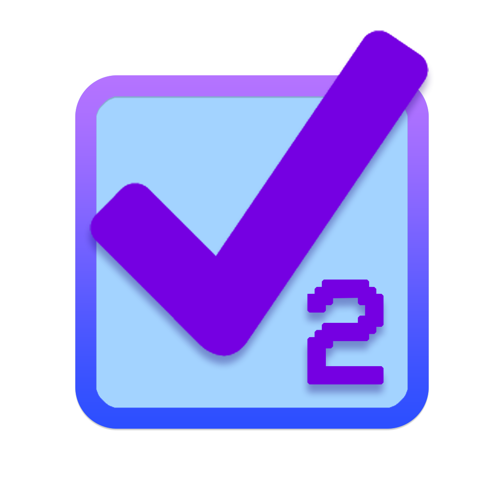
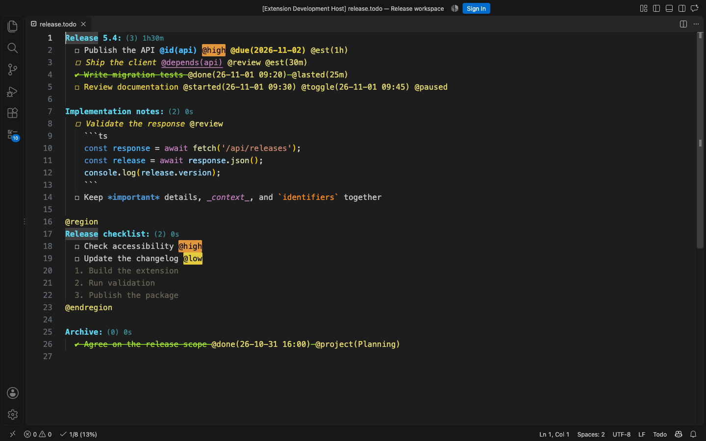
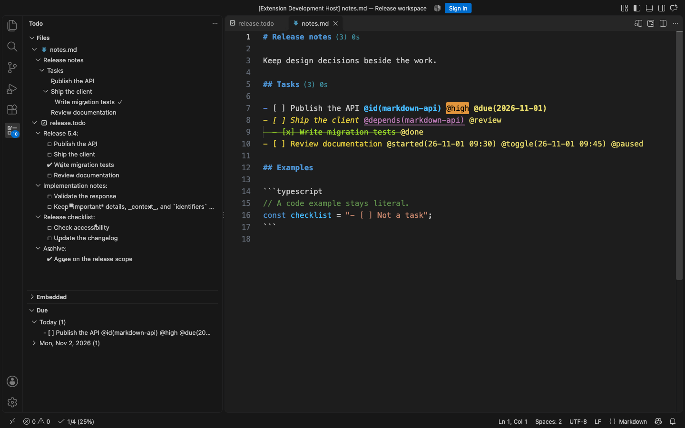

#  Todo+2

A lightweight, plain-text todo manager for Visual Studio Code. Powerful, customizable and easy to use. [View the demo](#demo).
This extension is a continuation of the original Todo+ extension by [Fabio Spampinato](https://github.com/fabiospampinato/vscode-todo-plus) and will break compatibility with some of the features. Old issues have been imported from the original repository and will be addressed.

[](https://marketplace.visualstudio.com/items?itemName=vycdev.vscode-todo-plus-two) [](https://marketplace.visualstudio.com/items?itemName=vycdev.vscode-todo-plus-two) [](https://marketplace.visualstudio.com/items?itemName=vycdev.vscode-todo-plus-two&ssr=false#review-details) [](https://github.com/vycdev/vscode-todo-plus-two/actions/workflows/check.yml) [](LICENSE) [](https://www.patreon.com/cw/vycdev)

## Features

- **Easy to use**: you're just a few shortcuts away from becoming a master
- **Portable**: being a plain text format you can read and edit it using any editor
- **Custom symbols**: you can replace the default symbols with any symbol you want
- **Supported symbols**: the extension recognizes the Todo+ Unicode symbols and Markdown-style checkboxes by default.
  - **Box**: `☐` or Markdown `- [ ]`
  - **Done**: `✔` or Markdown `- [x]`
  - **Cancelled**: `✘` (cancelled is only supported via the Unicode symbol)
- **Custom colors**: all colors can be customized
- **Custom special tags**: special tags' names and their colors can be customized
- **Tag-based task styles**: tags can color task text or apply bold, italic, and strikethrough, with configurable priority and tag-order precedence
- **Archive**: you can move finished todos to a special "Archive" section with a shortcut
- **Formatting**: you can format text in a markdown-like fashion, we support: **bold**, _italic_, ~~strikethrough~~ and `code`
- **Go To Symbol**: you can easily move between projects by using the `Go to Symbol in File...` command
- **Timekeeping**: you can mark todos as started and track elapsed time until completion
- **Timer**: a timer can be displayed in the statusbar for started todos
- **Time estimates**: you can estimate the time it will take to complete a todo by adding a tag to it that looks like this: `@est(3 hours)`, `@est(2h30m)` or `@2h30m`. Then you can use the `[est]`, `[est-total]`, `[est-finished]` and `[est-finished-percentage]` tokens in statistics
- **Task dependencies**: give a task a manual `@id(release-api)` and reference it from any Todo file with `@depends(release-api)`. The extension validates links, helps insert and rename references, and blocks premature completion.
- **Statistics**: statistics about your entire file and/or project-level statistics about your individual projects
- **Embedded todos**: it's common to have `//TODO` or `//FIXME` comments in our code, this extension can find those as well, including inline and multiline Liquid comment blocks
- **Markdown notes**: manage checklists and Todo+ tasks inside Markdown notes, with section grouping, task commands, due dates, statistics, dependencies, and timers. Notes keep their Markdown language mode and preview.
- **Activity bar views**: you can view your todo file and your embedded todos from a custom activity bar section

## Install

Requires Visual Studio Code 1.36 or newer.

Follow the instructions in the [Marketplace](https://marketplace.visualstudio.com/items?itemName=vycdev.vscode-todo-plus-two), or run the following in the command palette:

```shell
ext install vycdev.vscode-todo-plus-two
```

## Usage

It adds the following commonly used commands to the command palette:

```js
'Todo: Open'; // Open or create your project's todo file
'Todo: Open Embedded'; // Open embedded todos
'Todo: Toggle Box'; // Toggle todo's box symbol
'Todo: Toggle Done'; // Toggle todo's done symbol
'Todo: Toggle Cancelled'; // Toggle todo's cancelled symbol
'Todo: Toggle Start'; // Toggle a todo as started
'Todo: Toggle Timer'; // Pause or resume time tracking for the selected started task
'Todo: Sync Paused Tags'; // Repair @paused markers on selected task lines from their timing history
'Todo: Toggle Status Bar Timer'; // Toggle the timer in the status bar
'Todo: Archive'; // Archive finished todos
'Todo: Unarchive'; // Restore an archived task to its project list (when todo.archive.type is InSameFile)
'Todo: Export to HTML'; // Export the active Todo file as a standalone HTML document
'Todo: Export to Markdown'; // Export the active Todo file as a Markdown task list
'Todo: Copy Project with Statistics'; // Copy the project at the cursor, including its rendered statistics
'Todo: Open Dependency'; // Search task IDs and open a referenced task
'Todo: Open Dependency at Cursor'; // Open the dependency under the cursor
'Todo: Add Dependency'; // Search task IDs and add one to the selected todo
'Todo: Find Dependents'; // Show todos that depend on an ID
'Todo: Rename Task ID'; // Rename an ID and all matching references
'Todo: Embedded View - Filter'; // Filter the embedded todos view
'Todo: Embedded View - Clear Filter'; // Clear the filter in the embedded todos view
'Todo: Embedded View - Toggle View All Files'; // Toggle between viewing all files or only the current one
'Todo: Reset Manual Order'; // Reset all saved ordering in the embedded todos view
```

It adds 8 shortcuts when editing a `Todo` file:

```js
'Cmd/Ctrl+Enter'; // Triggers `Todo: Toggle Box`
'Alt+Enter'; // Triggers `Todo: Toggle Box`
'Alt+D'; // Triggers `Todo: Toggle Done`
'Alt+C'; // Triggers `Todo: Toggle Cancelled`
'Alt+S'; // Triggers `Todo: Toggle Start`
'Alt+T'; // Triggers `Todo: Toggle Timer`
'Cmd/Ctrl+Shift+A'; // Triggers  `Todo: Archive`
'Cmd/Ctrl+Shift+U'; // Triggers `Todo: Unarchive` when todo.archive.type is InSameFile
```

### Tasks in Markdown notes

Markdown task support is enabled by default. Open a note or the Todo Files view to see tasks grouped by their headings and nested lists:

```markdown
# Release notes

Some notes about the release.

## Todos

- [ ] Publish the API @id(api) @due(2026-12-01)
- [ ] Ship the client @depends(api)
  - [x] Write tests

Big activity:
[ ] A Todo+ style task inside the note

## Architecture

[ ] Follow up on the design
```

Supported task markers include Markdown list checkboxes (`- [ ]`, `* [ ]`, `+ [ ]`, and numbered lists), checked `[x]`/`[X]` boxes, bare `[ ]` boxes, and the standard/configured Todo+ symbols. Headings, including Setext headings, and project/list groups appear only when they contain tasks. Tasks inside fenced or indented code, block quotes, front matter, and HTML comments are ignored, including fences opened directly after a list marker.

The Files view shows Markdown tasks alongside Todo files. Task actions preserve the original checkbox style, bullet, indentation, tags, and surrounding prose. Cancellation uses `@cancelled` on checkbox tasks, including when automatic completion timestamps are disabled. `@due`, `@id`, `@depends`, estimates, statistics, and timer tags work on task lines; examples, HTML-comment payloads, and tags in ordinary prose are excluded from these features. Backslash-escaped tags such as `\@done` remain literal, while tag arguments retain their plain-text spelling. Tag-like text inside another tag's argument is also literal: `@id(@done)` identifies a task without completing it. Added timestamps stay outside HTML comments. Markdown headings retain their theme styling, with optional Todo project statistics appended as editor decorations.

The usual task shortcuts work when the cursor is on a recognized Markdown task. Run `Todo: Toggle Box` from the command palette to turn eligible prose or a list item into a checkbox, or restore a checkbox after removing its marker. Headings and their Setext underlines, code, comments, quotes, and notes outside configured task sections remain excluded. Tag and dependency completions are also limited to task lines. Markdown editing, folding, and preview continue to use VS Code's Markdown support.

```json
{
  "todo.markdown.enabled": true,
  "todo.markdown.include": ["**/*.md", "**/*.markdown"],
  "todo.markdown.scope": "all",
  "todo.markdown.sections": ["Todo", "Todos", "Tasks"]
}
```

Set `todo.markdown.scope` to `"sections"` to limit discovery to the named headings and their subsections. Heading names match case insensitively, and each section ends at the next heading of the same or a higher level. A heading nested inside a list item also ends when that item ends. Parents outside selected sections provide grouping context and remain excluded from task actions and dependency discovery. Task discovery also respects `todo.file.exclude`, workspace `files.exclude`, and `todo.followSymlinks`. Each file is indexed once, even when its path matches both the Todo and Markdown include settings. Setting the document's language mode to Todo selects the existing Todo parser.

Archiving moves finished task blocks with their indented notes and finished children, while keeping Markdown headings and unrelated prose in the source. A finished parent with unfinished children stays in place; eligible finished children can still be archived. `InSameFile` uses a Markdown Archive heading and supports Unarchive. Restoring a child still finds its original parent after the parent's timekeeping or completion-cleanup tags change. If its parent path matches multiple destinations, tasks stay in the Archive until the parent labels identify a single destination. `InMultiSeparateFile` writes `ARCHIVE.<original-filename>`; `InSeparateFile` uses a shared `ARCHIVE.<todo-file-base-name>.md` at the workspace root. Archive tag cleanup applies to task lines, preserving note text and code examples. Project labels are escaped when necessary, and merges retain source tasks if the archive cannot expose every transferred task. Existing dirty-buffer, write-failure, and concurrent-transfer protections also apply to Markdown archives.

### Numbered lists

Press Enter at the end of a plain numbered item such as `1. First item` to insert the next number and renumber the following items. For example, inserting after the first item in `1, 2, 3` produces `1, 2 (new), 3, 4`. This is enabled by default; set `todo.autoRenumber` to `false` to disable it.

Numbering preserves the current item's number, indentation, and spacing after the dot. It updates only consecutive numbered lines with the same indentation, stopping at blank lines, headings, other text, or indentation changes. Enter on an empty item removes its marker. Use one cursor at the end of an item; other cursor positions, selections, and multiple cursors keep normal Enter behavior.

These numbered entries remain notes rather than checkbox todos. Configured Todo symbols take precedence: numbering falls back to normal Enter if it would create a Todo using one of those symbols. Use the usual Todo symbols for status, statistics, dependencies, and archiving. Numbering is updated only by Enter, not on open, save, deletion, paste, or reordering. Markdown-language documents and nested list numbering are outside this feature's scope.

### Task priorities

Use special tags as visual priority labels without changing the plain-text task format. The default `todo.tags.names` setting includes `critical`, `high`, and `low`, so these tags are highlighted automatically:

```todo
Release:
  ☐ Fix the production outage @critical
  ☐ Review the migration plan @high
  ☐ Update internal notes @low
```

Customize the special-tag names and their matching colors with `todo.tags.names`, `todo.colors.tags.background`, and `todo.colors.tags.foreground`. To highlight the entire task line, set corresponding entries in `todo.colors.tags.lineBackground`. Palette entries match tag names by array position. These labels do not sort tasks or otherwise change task behavior.

### Tag-based task styling

Use `todo.tags.styles` to style task text in Todo files and Markdown notes based on its literal tags. Rules match complete, case-sensitive tag names without the `@` prefix; arguments such as `@review(alex)` match the `review` rule. Tags do not need to appear in `todo.tags.names`. Markdown escapes, inline code, and HTML comments protect their contents from styling rules.

```json
{
  "todo.tags.styles": {
    "blocked": { "color": "#e54545", "bold": true },
    "review": { "color": "#e5d145", "italic": true },
    "obsolete": { "strikethrough": true },
    "hold": {
      "backgroundColor": "#504020",
      "dark": { "color": "#ffcc66" },
      "light": { "color": "#805000" }
    }
  }
}
```

Each rule supports `color`, `backgroundColor`, `bold`, `italic`, `strikethrough`, `priority`, and `dark`/`light` appearance overrides. Resolve conflicts separately for each property: higher priority wins, and the last matching tag wins ties. Custom rules have priority `0` unless specified. For example, `@blocked @review` gets yellow bold italic text with the rules above; reversing those tags makes the text red.

Built-in rules provide these defaults:

| Tag          | Priority | Default appearance                                           |
| ------------ | -------- | ------------------------------------------------------------ |
| `@done`      | 100      | `todo.colors.done` and `todo.decorations.done.strikethrough` |
| `@cancelled` | 100      | `todo.colors.cancelled`                                      |
| `@started`   | 10       | `todo.colors.started`                                        |
| `@paused`    | 20       | Yellow text (`#e5d145`)                                      |

Existing `todo.colors.dark`/`todo.colors.light` overrides also supply the built-in color defaults. Override individual properties in `todo.tags.styles`, or set an entire rule to `false` to disable it, for example `"done": false`. An explicit rule color takes precedence over its legacy color settings. An empty `color` or `backgroundColor` value leaves that property to the syntax theme, including within a `dark` or `light` override. When `todo.colors.enabled` is false, rule colors and backgrounds are disabled while font styles continue to apply.

Task-text styles exclude the tag labels and inline code spans. Special-tag label colors and `todo.colors.tags.lineBackground` remain separate controls. Applying a custom styling tag has no completion or timer effects: `@obsolete` can strike through an unfinished task, and `@hold` can highlight it without pausing time tracking.

Compatibility: only actual tags select these task-text styles. Existing symbol-only `✔`/`✘` tasks and checked Markdown boxes use syntax-theme styling until an `@done`/`@cancelled` tag is added. The extension does not rewrite existing files or force tags when `todo.timekeeping.finished.enabled` is false. Timestamp-free status tags are sufficient for styling.

Timer commands append a single `@paused` marker when pausing and remove it when resuming, unstarting, or finishing. Valid `@started(...)`/`@toggle(...)` history remains authoritative for time tracking; the styling renderer reads `@paused` without interpreting the history. Marker and timer changes are applied together, so undo/redo restores both. To repair markers after manual or external edits, or add markers to existing paused tasks, select task lines and run `Todo: Sync Paused Tags`. The command removes stale/duplicate markers, adds a trailing marker for a paused timer, and clears markers on finished or untimed tasks. Opening or editing a file alone does not rewrite its tags.

### Group tasks by tag

Set `todo.file.view.groupByTags` to collect tasks from every project and nesting level into tag groups within each file in the Files sidebar:

```json
{
  "todo.file.view.groupByTags": ["low", "high", "tag-a"]
}
```

The sidebar shows non-empty groups such as `@low (3)` in the configured order, with tasks in source order. A task with multiple selected tags appears once in each matching group. Tasks with none of the selected tags appear under `Other`. Names are case-sensitive; a leading `@` is optional, and tag arguments are ignored (`@low(review)` belongs to `@low`). Tags on project headers or parent tasks are not inherited. Inline code examples do not create groups; Markdown escapes and HTML comments are also ignored.

Grouping works with Todo files and Markdown notes and updates as you edit. The grouped view shows task rows with their original source paths, including projects and parent tasks; notes and project headers remain in the source. Finished-task visibility, hidden tag labels, text/path filtering, navigation, and task context-menu actions remain available. Filtering also matches the original source path. Grouping changes only the sidebar: source text, task status, dependencies, and statistics stay unchanged. Set the array back to `[]` to restore the project hierarchy.

For a temporary text search instead, use `Todo: Files View - Filter` and enter `@low`. Text filtering matches substrings, including longer tag names, rather than exact tags.

### Code blocks

Add fenced code notes to Todo files using at least three backticks and an optional language name:

````todo
Wallet Services:
  ☐ Generate a wallet
    ```ts
    const wallet = walletService.generate();
    console.log(wallet.address);
    ```
````

Language names and aliases follow [GitHub's Linguist catalog](https://github.com/github-linguist/linguist/blob/73ee9a3b277f398c37ca4ab0dea0193849de6460/lib/linguist/languages.yml), including `python`/`py`, `c++`/`cpp`, `bash`/`sh`, `rust`, `go`, `html`, `json`, `yaml`/`yml`, `js`, `jsx`, `ts`, and `tsx`. Names are case-insensitive; a space before the name is optional. Syntax colors come from the active theme and VS Code's installed TextMate grammars. Many common languages work with VS Code's bundled grammars; uncommon languages need an extension providing the corresponding grammar. Unlabelled blocks, unknown names, and unavailable grammars remain literal code. `todo.colors.code` continues to control inline code only.

Fences may be indented with spaces or tabs. Close a block with a line containing only backticks (at least as many as the opening fence), plus optional indentation or trailing whitespace. An unfinished block continues to the end of the file. Code stays literal regardless of `todo.formatting.enabled` or `todo.colors.enabled`: task symbols, project headers, and tags inside it do not affect Todo statistics, dependencies, due dates, or task commands. Code blocks are omitted from the Files tree and can be folded in the editor.

A block following a task at the same or deeper indentation moves with that task when archived or unarchived. Its code and relative whitespace are preserved while the task indentation changes. Close unfinished blocks before archiving. HTML and Markdown exports currently render code-block lines as ordinary notes; they do not export fenced syntax highlighting.

### Task dependencies

Task identities are plain text, so they remain intact when you copy, move, or archive tasks. Add a non-empty `@id(...)` to a task and reference it with `@depends(...)` elsewhere in the workspace:

```todo
Backend:
  ☐ Publish API contract @id(api/contract v2)

Frontend:
  ☐ Integrate the API @depends(api/contract v2)
```

The text inside the parentheses may contain spaces, punctuation, and Unicode. Leading and trailing whitespace is ignored; `)` and line breaks are not supported. `@id(...)` and `@depends(...)` have distinct colors, while VS Code supplies the normal link treatment for dependencies. Ctrl/Cmd-click a dependency, or press `F12` with the caret inside it, to open its task. A unique ID opens directly; if several tasks use the same ID, a picker presents every matching task.

When you type `@depends(`, completion suggests known task IDs. `Todo: Add Dependency` provides the same search in a command, `Todo: Find Dependents` lists every task that references the ID under the cursor, and `Todo: Rename Task ID` (or `F2`) updates every matching `@id(...)` and `@depends(...)` safely across the workspace.

Typing `@created` or `@now` offers timestamp completions using `todo.timekeeping.created.format`; `@created` inserts a Todo+ tag, while `@now` inserts only the formatted date and time.

Missing IDs receive a warning in the Problems panel. A task cannot be marked done or cancelled until every task with each referenced ID is finished; therefore, a duplicated ID deliberately requires _all_ of its matching tasks to be finished. Both colors are configurable with `todo.colors.id` and `todo.colors.dependency`.

### Global Todo files

To keep a Todo file in the **Files** sidebar when switching projects, add its absolute path to `todo.file.include` in **Preferences: Open User Settings (JSON)**:

```json
{
  "todo.file.include": ["**/TODO", "**/*.todo", "C:/Users/you/Documents/global.todo"]
}
```

On Linux or macOS, use a path such as `/home/you/global.todo` or `/Users/you/global.todo`. On Windows, use forward slashes as above or escape each backslash as `\\`. Paths refer to the filesystem where the extension runs, including in remote workspaces.

This example retains `TODO` and `*.todo` workspace discovery. Setting this array replaces the defaults; copy the default array from Settings before adding your path if you want to retain every supported filename. Workspace settings can override your User setting.

Relative entries remain workspace globs. Absolute entries name individual files, including paths with spaces or brackets; absolute wildcards, `~`, and environment-variable expansion are not supported. Global files also appear with no folder open. Changes, deletion, and recreation are detected by polling about once per second, and unsaved edits refresh the sidebar.

`todo.file.exclude`, enabled `files.exclude` rules, and `todo.followSymlinks` still apply. Exclusions match workspace-relative paths inside a workspace and full paths outside it. Missing or unreadable files are skipped without hiding other Todo files.

## Settings

```js
{
  "todo.file.name": "TODO", // Todo file name. Other supported names are: `*.todo`, `*.todos`, `*.task`, `*.tasks`, `*.taskpaper` and `todolist.txt`
  "todo.file.defaultContent": "\nTodo:\n  ☐ Item\n", // New todo files default content
  "todo.file.include": ["**/TODO", "**/TODO.md", ...], // Workspace globs or absolute paths to individual Todo files
  "todo.file.exclude": ["**/.git/**", ...], // Globs to use for excluding files
  "todo.followSymlinks": false, // Follow symbolic links when enumerating files (can cause cycles)
  "todo.file.batchSize": 50, // Number of Todo files to process in each discovery batch
  "todo.file.view.expanded": true, // Start the tree in an expanded state
  "todo.file.view.groupByTags": [], // Group tasks within each file by selected tag names; empty preserves the hierarchy
  "todo.file.view.showFinished": true, // Show done and cancelled tasks in the Todo files view
  "todo.file.view.showComments": false, // Show comment-only lines in the Todo files view
  "todo.file.view.showTags": true, // Show tags in Todo files view labels
  "todo.file.view.icons": true, // Show icons next to groups in the Todo files view
  "todo.automaticSymbol": false, // Insert a new todo box after pressing Enter at the end of a non-empty todo
  "todo.autoRenumber": true, // Continue plain numbered lists and renumber following items on Enter
  "todo.autoCompleteParents": false, // Mark parents done when Todo: Toggle Done completes all nested todos
  "todo.symbols.box": "☐", // Box symbol
  "todo.symbols.done": "✔", // Done symbol
  "todo.symbols.cancelled": "✘", // Cancelled symbol
  "todo.colors.enabled": true, // Apply Todo+ editor colors; disable to use the active syntax theme
  "todo.colors.done": "#a6e22e", // Done todo color
  "todo.colors.cancelled": "#f92672", // Cancelled todo color
  "todo.colors.started": "#4fc1ff", // Started todo color
  "todo.colors.code": "#fd971f", // Code color
  "todo.colors.comment": "#75715e", // Comment color
  "todo.colors.project": "#66d9ef", // Project color
  "todo.colors.projectStatistics": "#4694a3", // Project statistics color
  "todo.colors.tag": "#e6db74", // Tag color
  "todo.colors.id": "#4fc1ff", // Task ID color
  "todo.colors.dependency": "#c586c0", // Task dependency color
  "todo.colors.due.overdue": "#ae81ff", // Overdue @due tag color
  "todo.colors.due.today": "#f92672", // @due tag color for tasks due today
  "todo.colors.due.soon": "#e5d145", // @due tag color for tasks due soon
  "todo.colors.due.later": "#a6e22e", // @due tag color for future tasks
  "todo.colors.tags.background": ["#e54545", "#e59f45", "#e5d145", "#ae81ff"], // Special tags' background colors
  "todo.colors.tags.foreground": ["#000000", "#000000", "#000000", "#000000"], // Special tags' foreground colors
  "todo.colors.tags.lineBackground": [], // Whole-line background colors for special tags, matched by todo.tags.names index; the first colored tag wins (include "started" in todo.tags.names to highlight @started)
  "todo.colors.types": { "TODO": "#ffcc00", "FIXME": "#cc0000" ... }, // Object mapping todo types to their color
  "todo.decorations.done.strikethrough": true, // Render done todos with strikethrough
  "todo.colors.dark": { /* "done": "white", ... */ }, // Colors for dark themes
  "todo.colors.light": { /* "done": "black", ... */ }, // Colors for light themes
  "todo.tags.names": ["critical", "high", "low", "today"], // Special tags' names
  "todo.tags.styles": { "blocked": { "color": "#e54545", "bold": true } }, // Task-text rules; built-in done/cancelled/started/paused rules are included by default
  "todo.tags.namesInference": true, // Infer commonly used tags' names
  "todo.due.soonDays": 7, // Number of days ahead that @due tags are considered due soon
  "todo.archive.name": "Archive", // Name of the special "Archive" section
  "todo.archive.remove.emptyProjects": true, // Remove projects without todos
  "todo.archive.remove.emptyLines": 1, // Remove extra empty lines, keeping no more than this many consecutive empty lines
  "todo.archive.remove.tags": ["today"], // Tags to remove from todos when archiving
  "todo.archive.project.enabled": true, // Enable the @project tag
  "todo.archive.project.separator": ".", // String used for joining multiple projects
  "todo.archive.sortByDate": false, // Sort lines by finished date
  "todo.archive.type": "InMultiSeparateFile", // Where to store archives: InSameFile, InSeparateFile, or InMultiSeparateFile (default)
  "todo.formatting.enabled": true, // Enable markdown-like formatting
  "todo.timekeeping.created.enabled": false, // Enable the @created tag
  "todo.timekeeping.created.time": true, // Insert the time inside the @created tag
  "todo.timekeeping.created.format": "YY-MM-DD HH:mm", // Format used for displaying time inside @created
  "todo.timekeeping.started.time": true, // Insert the time inside the @started tag
  "todo.timekeeping.started.format": "YY-MM-DD HH:mm", // Format used for displaying time inside @started
  "todo.timekeeping.autoToggle": false, // Automatically pause other active timers when starting a new task
  "todo.timekeeping.finished.enabled": true, // Enable the @done/cancelled tag. It's always enabled if you explicitly start a todo or if you use only 1 symbol
  "todo.timekeeping.finished.time": true, // Insert the time inside the @done/cancelled tag
  "todo.timekeeping.finished.format": "YY-MM-DD HH:mm", // Format used for displaying time inside @done/cancelled
  "todo.timekeeping.finished.remove.tags": ["today"], // Tags to remove when a todo is marked done or cancelled
  "todo.timekeeping.elapsed.enabled": true, // Enable the @lasted/wasted tag
  "todo.timekeeping.elapsed.format": "short-compact", // Format used for displaying time diff inside @lasted/wasted
  "todo.timekeeping.estimate.format": "short-compact", // Format used for the `[est]`, `[est-total]`, `[est-finished]` and `[est-finished-percentage]` tokens
  "todo.hoursPerDay": 24, // Number of hours represented by one day when formatting short time durations
  "todo.manHoursPerDay": 8, // Number of hours represented by one man-day when using man-time duration formats
  "todo.manDaysPerWeek": 5, // Number of man-days represented by one man-week when using man-time duration formats
  "todo.timer.statusbar.enabled": true, // Show a timer for started todos in the statusbar
  "todo.timer.statusbar.alignment": "left", // Should the item be placed to the left or right?
  "todo.timer.statusbar.color": "", // The foreground color for this item
  "todo.timer.statusbar.priority": -10, // The priority of this item. Higher value means the item should be shown more to the left
  "todo.statistics.project.enabled": "global.projects < 100 && project.all > 0", // Show statistics next to a project, boolean or token condition
  "todo.statistics.project.text": "([pending]) [est]", // Template used for rendering the text
  "todo.statistics.statusbar.enabled": "global.all > 0", // Show statistics in the statusbar, boolean or token condition
  "todo.statistics.statusbar.ignoreArchive": true, // Ignore the archive when rendering statistics in the statusbar
  "todo.statistics.statusbar.alignment": "left", // Should the item be placed to the left or right?
  "todo.statistics.statusbar.color": "", // The foreground color for this item
  "todo.statistics.statusbar.command": "", // Command to execute on click
  "todo.statistics.statusbar.priority": -1, // The priority of this item. Higher value means the item should be shown more to the left
  "todo.statistics.statusbar.text": "$(check) [finished]/[all] ([percentage]%)", // Template used for rendering the text
  "todo.statistics.statusbar.tooltip": "[pending] Pending - [done] Done - [cancelled] Cancelled", // Template used for rendering the tooltip
  "todo.embedded.regex": "(?:<!-- *)?(?:#|// @|//|/\\*+|<!--|--|\\* @|\\{!|\\{\\{!--|\\{\\{!|\\{%-? *comment *-?%\\}) *(TODO|FIXME|FIX|BUG|UGLY|HACK|NOTE|IDEA|REVIEW|DEBUG|OPTIMIZE)(?:\\s*\\([^)]+\\))?:?(?!\\w)(?: *\\{%-? *endcomment *-?%\\}| *-->| *\\*/| *!}| *--}}| *}}|(?= *(?:[^:]//|/\\*+|<!--|@|\\{!|\\{\\{!--|\\{\\{!))|((?: +[^\\n@]*?)(?= *(?:\\{%-? *endcomment *-?%\\}|-->|\\*/|!}|--}}|}}|[^:]//|/\\*+|<!--|@|\\{!|\\{\\{!--|\\{\\{!))|(?: +[^@\\n]+)?))", // Regex used for finding embedded todos, requires double escaping
  "todo.embedded.regexFlags": "gi", // Regex flags to use
  "todo.embedded.problems": {"TODO": "warning", "FIXME": "error"}, // Map embedded markers to Problems view severities (disabled by default)
  "todo.embedded.include": ["**/*"], // Globs to use for including files
  "todo.embedded.exclude": ["**/.*", "**/.*/**", ...], // Globs to use for excluding files
  "todo.embedded.batchSize": 50, // Number of files to process in each embedded-todo discovery batch
  "todo.embedded.showComments": false, // Show comment-only lines in the Embedded (side) view
  "todo.embedded.provider": "", // The provider to use when searching for embedded todos
  "todo.embedded.providers.ag.regex": "(?:#|// @|//|/\\*+|<!--|--|\\* @|\\{!|\\{\\{!--|\\{\\{!|\\{%-? *comment *-?%\\}) *(TODO|FIXME|FIX|BUG|UGLY|HACK|NOTE|IDEA|REVIEW|DEBUG|OPTIMIZE)", // Regex used by ag, requires double escaping
  "todo.embedded.providers.ag.args": ['--ignore-case'], // Extra arguments to pass to ag
  "todo.embedded.providers.rg.regex": "(?:#|// @|//|/\\*+|<!--|--|\\* @|\\{!|\\{\\{!--|\\{\\{!|\\{%-? *comment *-?%\\}) *(TODO|FIXME|FIX|BUG|UGLY|HACK|NOTE|IDEA|REVIEW|DEBUG|OPTIMIZE)", // Regex used by rg, requires double escaping
  "todo.embedded.providers.rg.args": ['--ignore-case'], // Extra arguments to pass to rg
  "todo.embedded.file.wholeLine": true, // Show the whole line
  "todo.embedded.file.groupByRoot": true, // Group embedded todos by workspace root
  "todo.embedded.file.groupByType": true, // Group embedded todos by type
  "todo.embedded.file.groupByFile": true, // Group embedded todos by file
  "todo.embedded.view.wholeLine": false, // Show the whole line
  "todo.embedded.view.showContext": false, // Show the following source line when it is non-blank and not another embedded todo
  "todo.embedded.view.sort": "line", // Sort by source line, label, or a manual workspace-local order
  "todo.embedded.view.groupByRoot": true, // Group embedded todos by workspace root
  "todo.embedded.view.groupByType": true, // Group embedded todos by type
  "todo.embedded.view.groupByFile": true, // Group embedded todos by file
  "todo.embedded.view.expanded": true, // Start the tree in an expanded state
  "todo.embedded.view.icons": true // Show icons next to todos and types
}
```

Symbols, colors, view settings, and embedded provider settings refresh when changed.

Statistics visibility conditions read `global` and `project` tokens, such as `global.all > 0 && project.pending > 0`. They support numeric/string/boolean literals, comparisons, arithmetic, logical operators, parentheses, and ternary expressions. Use bracket notation for hyphenated names, such as `project['est-total']`. Function calls, assignments, and arbitrary JavaScript execution are not supported; unsupported conditions evaluate to false.

An actual regex will be generated from the value of the `todo.embedded.regex` setting. It uses 2 capturing groups, the first one captures the type of the todo (`TODO`, `FIXME` etc.) and the second one captures an optional description (`TODO: description`).

To recognize a custom marker containing a hyphen, such as `// QUE-ES: investigate this`, keep the comment prefix outside the first capture and capture the entire marker name:

```json
{
  "todo.embedded.regex": "(?:#|//)\\s*(TODO|QUE-ES):?(?!\\w)([^\\n]*)",
  "todo.embedded.regexFlags": "gi",
  "todo.embedded.provider": "javascript"
}
```

The first capture must be `QUE-ES`, not the comment prefix. The second capture contains the description. This example uses the JavaScript provider; if you use `ag` or `rg`, also add the custom marker to `todo.embedded.providers.ag.regex` or `todo.embedded.providers.rg.regex` so the external search includes those files.

Dates are formatted using [moment](https://momentjs.com/docs/#/displaying/format).

`Todo: Toggle Timer` pauses and resumes a started task by appending `@toggle(...)` timestamps and maintaining an `@paused` styling marker. Paused time is excluded from the status bar timer and from the final `@lasted(...)` or `@wasted(...)` duration.

To contribute embedded markers to VS Code's Problems view, map each marker to an `error`, `warning`, `info`, or `hint` severity with `todo.embedded.problems`. Only configured markers are reported. Diagnostics are populated when Todo+2 is active, for example after opening the Embedded Todos view.

## Manual Embedded Ordering

Set `"todo.embedded.view.sort": "manual"`, then right-click a group, file, or todo in the Embedded view and choose **Move Up** or **Move Down**. Moves reorder siblings within their current parent. To prioritize todos from different files directly under a marker group, also set `"todo.embedded.view.groupByFile": false`.

On VS Code 1.66 or newer, you can also **drag a single group, file, or todo onto a sibling** to take its position. Dragging upward places the row before the target; dragging downward places it after the target. Drop onto another row in the same parent, rather than the empty area or a different group. Move Up/Down remains available on older supported VS Code versions.

The order is saved locally for the current workspace and survives refreshes and window reloads. Groups and files without saved ranks start alphabetically; todos start by file path and source position. Newly discovered entries appear after ranked siblings. Switching to `line` or `label` keeps the saved manual order for later use. Reordering is unavailable while filtering or showing only the active file, so hidden siblings cannot be moved accidentally.

Choose **Reset Manual Order** from the Embedded view's **...** menu, or run **Todo: Reset Manual Order**, to clear all saved ranks, including those for other grouping layouts. This restores the initial order without changing the sort setting.

Ordering only affects the sidebar; it does not edit source files or change the generated **Open Embedded** snapshot. Groups still represent captured marker types, not arbitrary trailing `@tags`. Custom workflow markers must be included in the embedded regex and any external provider regex, as described above.

Inserting source lines or changing label/context display settings preserves an unchanged comment's rank. Renaming its file or editing the matched comment treats it as a new entry. Identical comments are distinguished by occurrence within a file; deleting or rearranging identical occurrences can change which one receives a saved rank.

## Embedded Todos Providers

This extension supports various providers for searching for embedded todos, it'll use the one you set via the `todo.embedded.provider` setting or the first one available between:

1. **[ag / The Silver Searcher](https://github.com/ggreer/the_silver_searcher)**: About 50x faster than the `javascript` provider, it'll use the regex defined under `todo.embedded.providers.ag.regex`. It must be installed in your system.
2. **[rg / ripgrep](https://github.com/BurntSushi/ripgrep)**: About 50x faster than the `javascript` provider, it'll use the regex defined under `todo.embedded.providers.rg.regex`. It doesn't support lookaheads and lookbehinds. It must be installed in your system, or Visual Studio Code must include it.
3. **javascript**: Works on every system, but it's quite slow. This is the fallback provider.

`ag` and `rg` will use their specific regexes for finding the lines containing embedded todos, then those lines will be searched in using the regex defined under `todo.embedded.regex`.

## Statistics Tokens

The following tokens can be used in `todo.statistics.project.text`, `todo.statistics.statusbar.text` and `todo.statistics.statusbar.tooltip`, they will be replaced with the value they represent.

| Token                       | Value                                          |
| --------------------------- | ---------------------------------------------- |
| `[comments]`                | Number of comments                             |
| `[projects]`                | Number of projects                             |
| `[tags]`                    | Number of tags                                 |
| `[pending]`                 | Number of pending todos                        |
| `[done]`                    | Number of done todos                           |
| `[cancelled]`               | Number of cancelled todos                      |
| `[finished]`                | Number of finished todos                       |
| `[all]`                     | Number of todos                                |
| `[percentage]`              | Percentage of finished todos                   |
| `[est]`                     | Estimated time left                            |
| `[est-total]`               | Total estimated time                           |
| `[est-finished]`            | Estimated time of finished todos               |
| `[est-finished-percentage]` | Percentage of estimated time in finished todos |
| `[lasted]`                  | Time the task lasted                           |
| `[wasted]`                  | Time wasted on task                            |
| `[elapsed]`                 | Sum of `[lasted]` and `[wasted]`               |

Tag-scoped tokens use `[tag:selector:metric]`. The metric can be any task or time token
from the table, and defaults to `all`, so `[tag:high]` counts todos tagged `@high` while
`[tag:high:elapsed]` reports their elapsed time. Join tag names with `&` to require every
tag or `|` to accept any tag: `[tag:frontend&high:pending]` and
`[tag:frontend|backend:done]`. `&` is evaluated before `|`, the leading `@` is optional,
and tag arguments do not affect matching (`@high(review)` matches `high`). These tokens
work in project text, status bar text and status bar tooltips.

## Demo

### [Example todo file](https://github.com/vycdev/vscode-todo-plus-two/blob/master/resources/readme.todo)



### Embedded todos


### Activity bar views



### Statistics


### Timekeeping & Timer


## Hints

- **Dark/Light Themes**: if you switch between dark and light themes, remember that you can provide specific colors for them via the `todo.colors.dark.*` and `todo.colors.light.*` settings, which will override the default `todo.colors.*` settings.

- **Theme Syntax Colors**: set `todo.colors.enabled` to `false` to disable Todo+ editor colors and let the active syntax theme style projects, tasks, comments, formatting and tags. Done-task strikethrough and rendered project statistics remain available.

- **Activity Bar**: you can switch the focus to the `Todo` activity bar view by assigning a shortcut to the `workbench.view.extension.todo` command.

- **Icons**: icons can be used in `todo.statistics.statusbar.text`. [Here](https://octicons.github.com/) you can browse a list of supported icons. If for instance you click the first icon, you'll get a page with `.octicon-alert` written in it, to get the string to use simply remove the `.octicon-` part, so in this case the icon name would be `alert`.

- **CLI**: you can view your embedded todos from the command line with the `todo` command if you install [ag](https://github.com/ggreer/the_silver_searcher) and add the following to your shell configuration file:

```bash
alias todo="ag --color-line-number '1;36' --color-path '1;36' --ignore-case --print-long-lines --silent '(?:<!-- *)?(?:#|//|/\*+|<!--|--) *(TODO|FIXME|FIX|BUG|UGLY|HACK|NOTE|IDEA|REVIEW|DEBUG|OPTIMIZE)(?:\([^(]+\))?:?(?!\w)(?: *-->| *\*/|(?= *(?:[^:]//|/\*+|<!--|@))|((?: +[^\n@]*?)(?= *(?:-->|\*/|[^:]//|/\*+|<!--|@))|(?: +[^@\n]+)?))'"
```

## Contributing

If you found a problem, or have a feature request, please open an [issue](https://github.com/vycdev/vscode-todo-plus-two/issues) about it.

You can find more about contributing here: [CONTRIBUTING.md](/CONTRIBUTING.md)

Run `npm run check` for types, unit/integration tests, the development build, and formatting. Run `npm run test:e2e:tags` in a desktop session with Node.js 22 or newer to launch an isolated VS Code Extension Development Host for tag styling. It exercises real task commands, undo/redo, dependencies, archiving, Markdown handling, live settings, and rendered styles in dark and light themes. The runner downloads VS Code through `@vscode/test-electron` and writes a JSON report and screenshots to a temporary artifact directory. The separate `npm run test:e2e` suite covers fenced code notes.

Set `VSCODE_EXECUTABLE_PATH` to reuse a VS Code executable, `VSCODE_TEST_VERSION` to select a version, or `TODO_E2E_ARTIFACT_DIR` to choose where reports and screenshots are saved. Tests use a temporary workspace, profile, and extensions directory.

## License

MIT © vycdev
